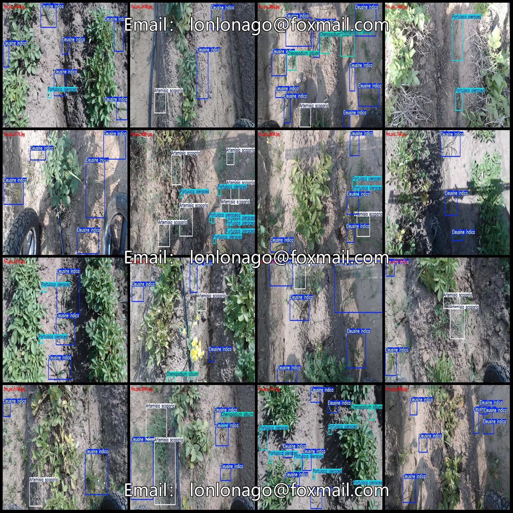
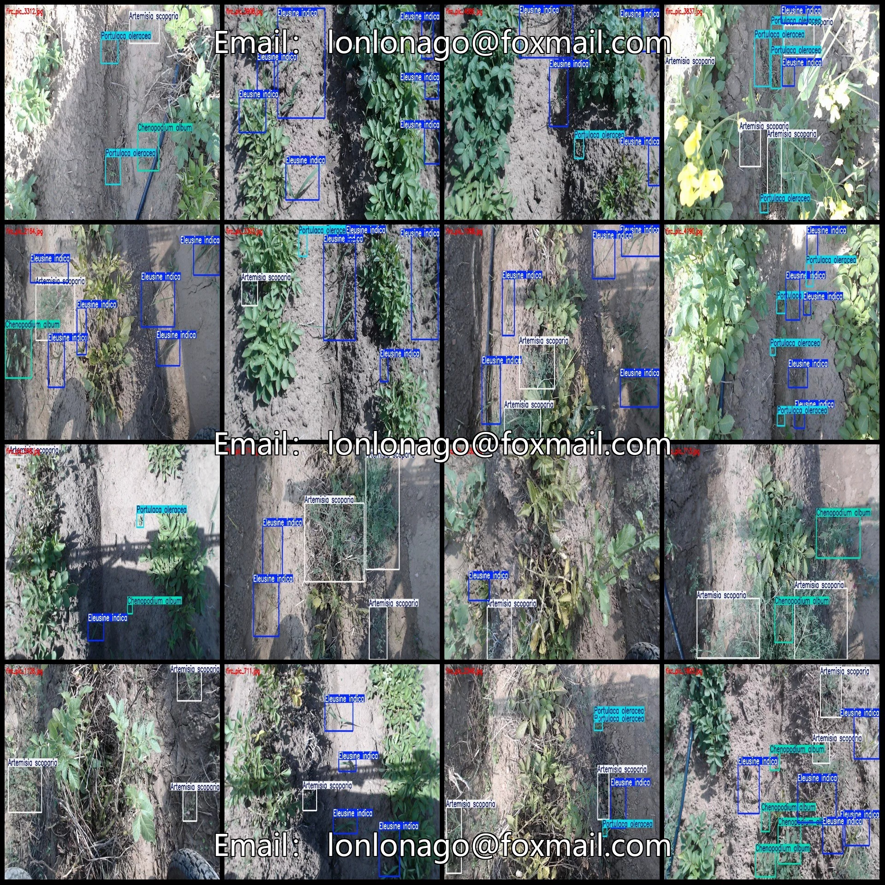
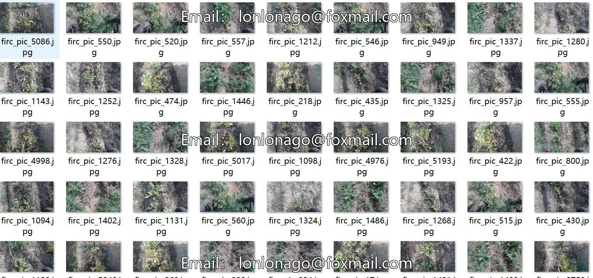
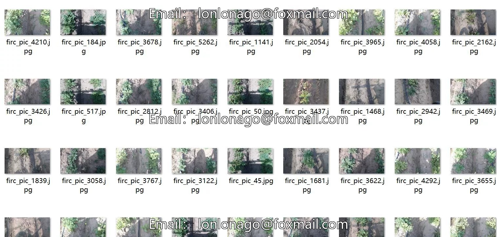
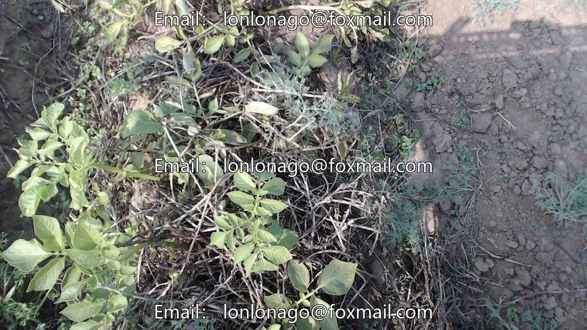

# UAV Low-altitude Shooting of Potato Tuber Young Plants and Weed Detection Dataset VOC+Y

## Body

Drone-view low-altitude photography of potato sprouts and weed detection dataset VOC+YOLO format with 5266 images in 6 classes
Warm reminder: Due to the dataset's replicability, please confirm compliance before purchasing.
Dataset format: Pascal VOC format + YOLO format (txt file without split path, only containing jpg images and corresponding VOC format xml files and yolo format txt files)
Number of images (number of jpg files): 5266
Number of annotations (number of xml files): 5266
Number of annotations (number of txt files): 5266
Number of annotation categories: 6

Annotation Category Names: ["Artemisia scoparia", "Chenopodium album", "Digitaria sanguinalis", "Eleusine indica", "Portulaca oleracea", "Sonchus arvensis"]
Number of Boxes per Category
Artemisia scoparia (Indigo Seed) = 7713

Chenopodium album (L.) Frames = 2272
Digitaria sanguinalis (L.) Frames = 28
Eleusine indica (L.) Frames = 13679
Portulaca oleracea (L.) Frames = 7556
Sonchus arvensis (L.) Frames = 416
Total Frames: 31664
Number of Images per Classification
Artemisia scoparia (L.) Number of Images = 3296

Chenopodium album (L.) (Pakchoi) occupies 1420 images
Digitaria sanguinalis (L.) (Common lamb's quarter) occupies 21 images
Eleusine indica (L.) (Cornflower) occupies 4063 images
Portulaca oleracea (L.) (Mache) occupies 1915 images
Sonchus arvensis (L.) (Cabbage mustard) occupies 185 images
Image resolution: 1280x720
Labeling tool used: labelImg
Labeling rules: Draw rectangles around the category labels

Important Notice: The dataset does not have separate training, validation, and test sets; you need to partition them yourself.
Special : This dataset does not guarantee the accuracy of the trained models or weight files.

## Images

## Payment

Here is a pay link on Stripe ( https://buy.stripe.com/3cs8yP7sY87d0vu9AB ). Please contact me lonlonago@foxmail.com after funding $89, and I will send you a complete data files , thank you!

